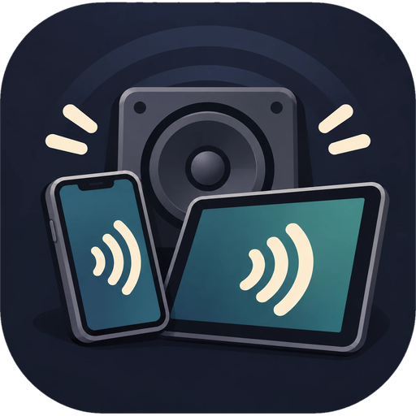

<p align="center"></p>

# Speaker Anywhere

Play your computer's audio on any device that has a browser and a speaker, over Wi-Fi. Phones, tablets, laptops, other PCs. Nothing to install on the receiving device and no virtual cable.

Open the app, press **Start**. It listens to your default output by default; the **Output** list lets you pick a specific device instead, even while it is running (`--device NAME` and `--list-devices` do the same in the terminal; macOS always captures the system mix). The window expands to show a QR code and a link. Scan the code with a phone camera, or open the link on any other device on the same Wi-Fi, then tap **Start** on the page.

## Download

Get the file for your system from the [latest release](../../releases/latest).

| System | File | Notes |
|---|---|---|
| Windows 10/11 | `SpeakerAnywhere-Setup.exe` | Installer. Unsigned, so SmartScreen may warn: More info, Run anyway. Adds a Private-network firewall rule. |
| Linux (x64) | `SpeakerAnywhere-linux-x64.tar.gz` | Extract and run `speaker-anywhere/speaker-anywhere`. Needs `pulseaudio-utils` (PipeWire: `pipewire-pulse`). Tested against a real PulseAudio server in CI. |
| macOS 13+ | `SpeakerAnywhere-macOS.dmg` | Unsigned: right-click the app, Open. On first Start, allow it under System Settings, Privacy & Security, Screen & System Audio Recording. Captures system audio with ScreenCaptureKit. Not yet tested on a real Mac. |

## Code signing

Windows releases are signed using free code signing provided by [SignPath.io](https://signpath.io), with a certificate by the [SignPath Foundation](https://signpath.org). Until signing is active, the installer is unsigned and SmartScreen may warn.

## Privacy

Speaker Anywhere collects no data and sends nothing to the internet. Audio goes only from your computer to devices on your own network that open the link or QR code.

## How it works

- Windows: WASAPI loopback of the default output device, followed automatically if the default changes.
- Linux: the monitor of the default PulseAudio/PipeWire output, followed if the default changes.
- macOS: a small Swift helper (`macos/sa-audio-tap.swift`) using ScreenCaptureKit.
- The receiving device plays with Web Audio and keeps a small jitter buffer (40/80/160 ms), dropping chunks when it falls behind.
- iPhone silent switch: uses `navigator.audioSession` plus a silent looping `<audio>` element.

## From source

```
pip install -r requirements.txt
python speaker_anywhere.py            # window
python speaker_anywhere.py --cli      # terminal
python speaker_anywhere.py --firewall # Windows only: allow the port on Private networks (asks for admin)
```

On Linux you also need `python3-tk` and `pulseaudio-utils`. On macOS build the helper first: `swiftc -O macos/sa-audio-tap.swift -o macos/sa-audio-tap`.

## Builds

Linux and macOS packages are built by `.github/workflows/build.yml`. The Linux job streams a test tone through a virtual sound card and checks that it arrives. The Windows installer is built locally:

```
pip install pyinstaller
py -3 -m PyInstaller --noconfirm --clean --windowed --onedir --name SpeakerAnywhere --icon assets/icon.ico --add-data "assets/icon.ico;assets" --collect-all pyaudiowpatch --distpath build/dist --workpath build/work --specpath build speaker_anywhere.py
ISCC.exe installer.iss        # Inno Setup 6 -> output/SpeakerAnywhere-Setup.exe
```
